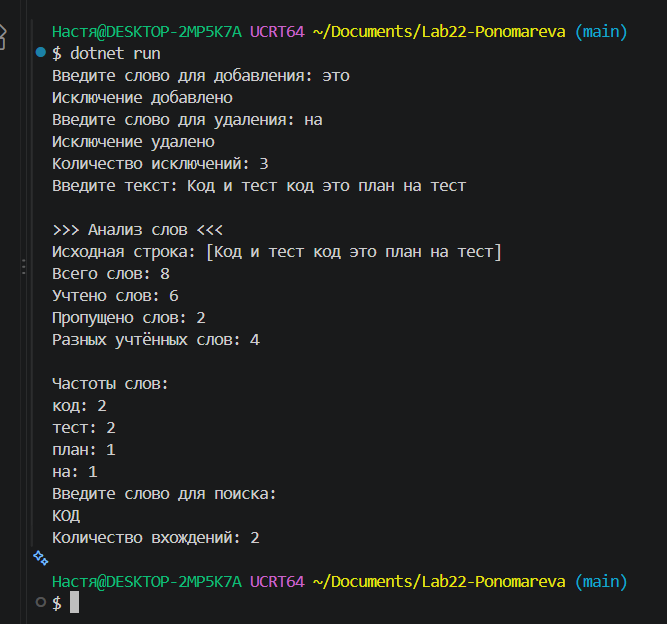

# Практическая работа №22
Автор: Пономарева Анастасия
Группа: ИСП-252

## Тема
Dictionary и HashSet в C#.

## Что реализовано
- хранение исключений в HashSet;
- добавление и удаление исключений;
- подготовка и разделение текста на слова;
- подсчёт частот в Dictionary;
- вывод общей статистики;
- безопасный поиск слова через TryGetValue.

## Короткие ответы

1. Что должно быть уникальным в Dictionary и в HashSet?
Ответ: в Dictionary уникальны ключи - двух одинаковых ключей быть не может, а значения могут повторяться. В HashSet уникален каждый элемент: повторное добавление равного элемента ничего не меняет

2. Чем отличается повторное добавление в HashSet от Dictionary.Add() с существующим ключом?
Ответ: HashSet.Add() при повторе не добавляет элемент, возвращает false и не вызывает исключение - Count остаётся прежним. Dictionary.Add() при существующем ключе выбрасывает исключение, поэтому новое значение существующему ключу задают присваиванием через квадратные скобки, а не через Add()

3. Почему для поиска по неизвестному ключу удобно использовать TryGetValue()?
Ответ: он не вызывает исключения при отсутствии ключа, как прямое чтение dictionary[key], и возвращает false. За один вызов он даёт сразу два результата - есть ли ключ и его значение

## Результат

